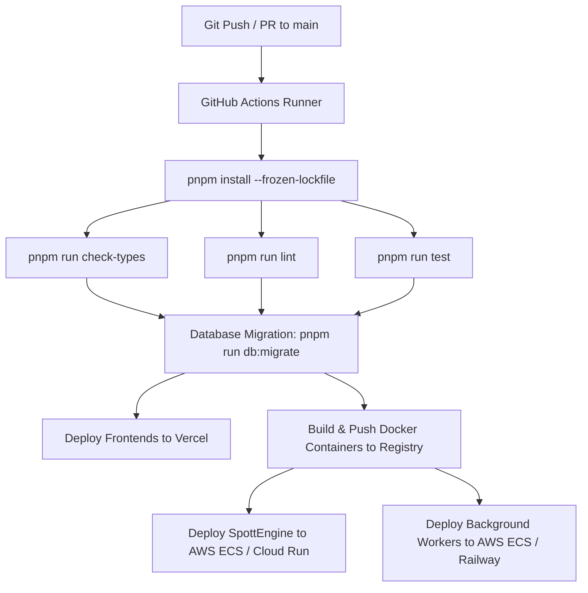

# Deployment Strategy Architecture

This document defines the production deployment strategy, containerization workflow, CI/CD pipeline, and infrastructure topology for the **SpottGeo Monorepo**.

---

## 🏛️ Deployment Topology Overview

SpottGeo is structured as a **Unified TypeScript Monorepo** managed with **pnpm workspaces** and **Turborepo**. The application components are decoupled by design into independent runtime targets:

```
                                    +-----------------------------------+
                                    |         DNS / Domain Router       |
                                    +-----------------+-----------------+
                                                      |
              ┌───────────────────────────────────────┼───────────────────────────────────────┐
              │                                       │                                       │
              v                                       v                                       v
+---------------------------+               +---------------------------+               +---------------------------+
|       FRONTEND LAYER      |               |      CORE API LAYER       |               |    BACKGROUND WORKERS     |
|   (Vercel / Cloudflare)   |               |  (AWS ECS / Railway / Fly)|               | (AWS ECS / Railway Workers|
|                           |               |                           |               |                           |
|  - console.spottgeo.com   |               |  - api.spottgeo.com       |               |  - payout-worker          |
|  - drop.spottgeo.com      |               |    (SpottEngine :8080)     |               |  - webhook-dispatcher     |
|  - verify.spottgeo.com    |               |                           |               |  - analytics-worker       |
+---------------------------+               +-------------+-------------+               +-------------+-------------+
                                                          |                                           |
                                                          v                                           v
                                            +---------------------------------------------------------------+
                                            |                  MANAGED DATABASE LAYER                       |
                                            |               AWS RDS / Supabase / Neon                       |
                                            |               (PostgreSQL + PostGIS)                          |
                                            +---------------------------------------------------------------+
```

---

## 🎯 Component-by-Component Deployment Specification

### 1. Frontend Layer (`apps/console`, `apps/drop`, `apps/verify`)
- **Hosting Platform**: Vercel / Cloudflare Pages
- **Runtime**: Next.js 16 (Turbopack) Serverless / Edge Runtime
- **Build Command**: `pnpm run build --filter=<app_name>`
- **Output Directory**: `.next`
- **Features**:
  - Global CDN caching for static PWA assets.
  - Automatic Preview Deployments per GitHub Pull Request.
  - Custom domain routing (`console.spottgeo.com`, `drop.spottgeo.com`, `verify.spottgeo.com`).

### 2. Core API Layer (`services/engine`)
- **Hosting Platform**: AWS ECS Fargate / GCP Cloud Run / Railway / Render / Fly.io
- **Runtime**: Node.js v20+ / Fastify API Server
- **Port**: `8080`
- **Build Command**: `npx turbo prune --scope=@spottgeo/engine --docker`
- **Start Command**: `pnpm --filter @spottgeo/engine start`
- **Health Check**: `GET http://localhost:8080/health` (Returns `200 OK`)
- **Autoscaling**: Scale HTTP container instances based on CPU (>70%) or HTTP request concurrency during nationwide campaign spikes.

### 3. Background Worker Layer (`services/payout-worker`, `services/webhook-dispatcher`, `services/analytics-worker`)
- **Hosting Platform**: AWS ECS Fargate Tasks / Railway Background Workers / Render Worker Services
- **Runtime**: Node.js v20+ Long-Running Processes
- **Ports**: None (Background execution loops; 0 exposed HTTP ports)
- **Start Commands**:
  - Payout Worker: `pnpm --filter @spottgeo/payout-worker dev` / `node dist/worker.js`
  - Webhook Dispatcher: `pnpm --filter @spottgeo/webhook-dispatcher dev` / `node dist/dispatcher.js`
  - Analytics Worker: `pnpm --filter @spottgeo/analytics-worker dev` / `node dist/aggregator.js`
- **Isolation**: Workers operate asynchronously without blocking main-thread API traffic or exposing public web ports.

### 4. Database Layer (`packages/database`)
- **Engine**: PostgreSQL v15+ with `postgis` and `uuid-ossp` extensions enabled.
- **Provider**: AWS RDS PostgreSQL / Neon / Supabase
- **ORM**: Drizzle ORM (`@spottgeo/database`)
- **Migration Command**: `pnpm run db:migrate` (Executed as a pre-deployment step in CI/CD pipeline).

---

## ⚡ Containerization & Turborepo Pruning Strategy

To avoid copying unnecessary workspace packages into Docker containers, SpottGeo utilizes Turborepo's `turbo prune` command. This creates an isolated workspace subset containing **only** the target package and its internal workspace dependencies.

### Multi-Stage Dockerfile (`services/engine/Dockerfile`)

```dockerfile
# Stage 1: Prune Workspace
FROM node:20-alpine AS pruner
WORKDIR /app
RUN npm install -g pnpm turbo
COPY . .
RUN turbo prune --scope=@spottgeo/engine --docker

# Stage 2: Install & Build
FROM node:20-alpine AS builder
WORKDIR /app
RUN npm install -g pnpm
COPY --from=pruner /app/out/json/ .
COPY --from=pruner /app/out/pnpm-lock.yaml ./pnpm-lock.yaml
RUN pnpm install --frozen-lockfile

COPY --from=pruner /app/out/full/ .
RUN pnpm --filter @spottgeo/engine build

# Stage 3: Runner (Minimal Production Image)
FROM node:20-alpine AS runner
WORKDIR /app
ENV NODE_ENV=production
RUN npm install -g pnpm

COPY --from=builder /app ./

EXPOSE 8080
CMD ["pnpm", "--filter", "@spottgeo/engine", "start"]
```

---

## 📊 Deployment Options Comparison Matrix

| Deployment Strategy | Target Audience | Est. Monthly Cost | Setup Effort | Scalability |
| :--- | :--- | :--- | :--- | :--- |
| **Option A: PaaS Hybrid** *(Recommended for Growth)* | Startups / Growth | $20 – $100 | ⚡ 1 Hour | 🟢 High (Auto-scales Next.js & Fastify) |
| **Option B: AWS Cloud Native** | Scaleup / Enterprise | $150 – $800 | 🛠️ 1–2 Days | 🟢 Unlimited (VPC, IAM, ECS Fargate) |
| **Option C: Single VPS Docker Compose** | Staging / MVP | $12 – $24 | ⚡ 30 Mins | 🔴 Fixed Single Host Capacity |

---

## 🔄 Automated CI/CD Pipeline Blueprint



---

## 🔑 Environment Variables & Secret Management

| Variable Name | Component Access | Description |
| :--- | :--- | :--- |
| `DATABASE_URL` | Engine, Workers, Console | Connection string to PostgreSQL instance (`postgres://...`) |
| `NODE_ENV` | All Components | `production` / `development` / `test` |
| `PORT` | Engine, Apps | Service binding port (`8080`, `3000`, `3001`, `3002`) |
| `NEXT_PUBLIC_ENGINE_URL` | Apps (`drop`, `verify`, `console`) | Public API endpoint for SpottEngine (`https://api.spottgeo.com`) |
| `PAYSTACK_SECRET_KEY` | Payout Worker | Secret key for Paystack airtime/data payout integration |
| `VTPASS_SECRET_KEY` | Payout Worker | Secret key for VTpass utility payout integration |
| `WEBHOOK_HMAC_SECRET` | Webhook Dispatcher | Shared cryptographic secret key for signing outbound webhooks |
