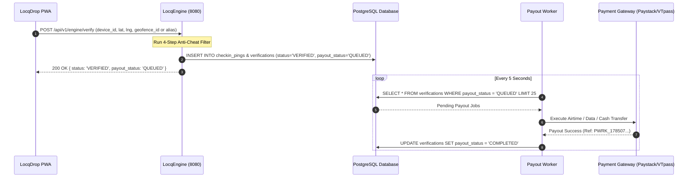
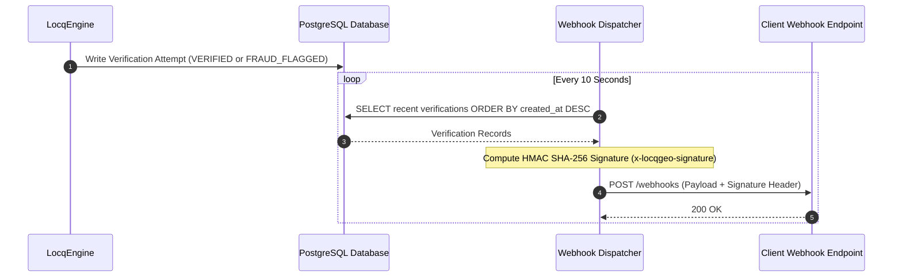
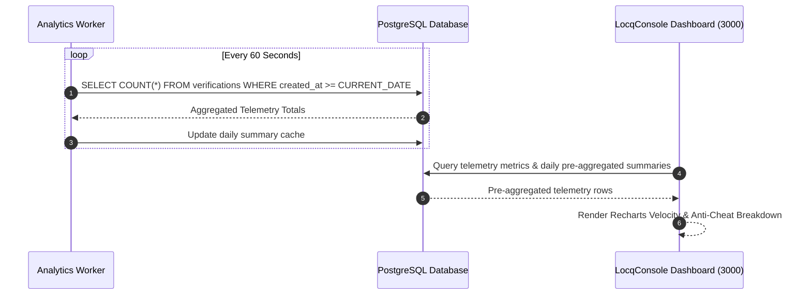

# Inter-App Communication Architecture

This document details how applications, services, and packages within the **LocqGeo Monorepo** communicate with each other, exchange data, enforce type contracts, and process asynchronous events.

---

## 🏛️ System Topology

```
+-----------------------------------------------------------------------------------+
|                                  CLIENT LAYER                                     |
|                                                                                   |
|   +-----------------------+   +-----------------------+   +-------------------+   |
|   |      LocqDrop        |   |      LocqVerify      |   |    LocqConsole   |   |
|   |  Consumer PWA (3001)  |   |  Consumer PWA (3002)  |   |  B2B Admin (3000) |   |
|   +-----------+-----------+   +-----------+-----------+   +---------+---------+   |
+---------------|---------------------------|-------------------------|-------------+
                |                           |                         |
                | HTTP POST                 | HTTP POST               | Direct DB &
                | /api/v1/engine/verify     | /api/v1/engine/verify   | Telemetry API
                v                           v                         v
+-----------------------------------------------------------------------------------+
|                                CORE API LAYER                                     |
|                                                                                   |
|                       +----------------------------------+                        |
|                       |           LocqEngine            |                        |
|                       |   Node.js + Fastify API (8080)   |                        |
|                       +-----------------+----------------+                        |
+-----------------------------------------|-----------------------------------------+
                                          |
                        Zod Schemas       | Drizzle ORM Queries
                  (@locqgeo/api-contracts) | (@locqgeo/database)
                                          v
+-----------------------------------------------------------------------------------+
|                                 DATA & WORKER LAYER                               |
|                                                                                   |
|                               +------------------+                                |
|                               | PostgreSQL DB    |                                |
|                               | (Table Queues)   |                                |
|                               +--------+---------+                                |
|                                        |                                          |
|            ┌───────────────────────────┼───────────────────────────┐              |
|            │ Polling Loop              │ Polling Loop              │ Aggregate    |
|            v (5s)                      v (10s)                     v (60s)        |
|  +-------------------+       +-------------------+       +-------------------+    |
|  |   Payout Worker   |       | Webhook Dispatcher|       | Analytics Worker  |    |
|  | (services/payout) |       | (services/webhook)|       | (services/analyt) |    |
|  +---------+---------+       +---------+---------+       +---------+---------+    |
+------------|---------------------------|---------------------------|--------------+
             |                           |                           |
             v                           v                           v
     External Gateways           Client Webhooks             Pre-Aggregated
   (Paystack/VTpass/FW)        (HMAC SHA-256 Signed)         Console Analytics
```

---

## 📡 Communication Mechanisms

Inter-app communication in LocqGeo uses four distinct patterns depending on latency and coupling requirements:

### 1. HTTP REST APIs (Synchronous Client-to-Engine)

- **Protocols**: HTTP/1.1 (JSON)
- **Primary Endpoint**: `POST /api/v1/engine/verify` hosted by `LocqEngine` on port 8080.
- **Participants**: `LocqDrop` (Consumer PWA) and `LocqVerify` (Attendance PWA) invoke `LocqEngine`.
- **Purpose**: Real-time evaluation of location-aware verification claims and configured risk signals. Server latency is measured against a defined benchmark; mobile end-to-end latency depends on device, GPS, and network conditions.

### 2. Real-Time Telemetry Event Streaming (SSE)

- **Protocols**: Server-Sent Events (`text/event-stream`)
- **Primary Endpoint**: `GET /api/v1/engine/telemetry/stream` hosted by `LocqEngine`.
- **Participants**: `LocqEngine` (Broadcaster) $\rightarrow$ `LocqConsole` (`useTelemetryStream` hook).
- **Purpose**: Real-time streaming of verification telemetry events (`VERIFIED`, `VERIFIED_FLAGGED`, `REJECTED_SPOOF`) directly into the executive fraud dashboard.

### 3. Payment Ingestion Webhooks (Paystack & Stripe)

- **Protocols**: Signed Inbound HTTP POST (`/api/v1/webhooks/paystack`, `/api/v1/webhooks/stripe`).
- **Signature Security**: HMAC SHA-512 (`x-paystack-signature`) and HMAC SHA-256 (`stripe-signature`).
- **Participants**: Paystack / Stripe Payment Gateways $\rightarrow$ `LocqEngine` $\rightarrow$ `@locqgeo/feature-gate` (Redis cache invalidation).

### 2. Database Asynchronous Queues (Decoupled Worker Pattern)

- **Pattern**: Transactional Outbox / Table-as-Queue pattern over PostgreSQL.
- **Participants**: `LocqEngine` (Producer) $\rightarrow$ PostgreSQL $\rightarrow$ `PayoutWorker`, `WebhookDispatcher`, `AnalyticsWorker` (Consumers).
- **Purpose**:
  - `LocqEngine` writes verification records to the database with `payout_status = 'QUEUED'` during presence validation.
  - Background workers poll PostgreSQL at fixed intervals (`5000ms` for payouts, `10000ms` for webhooks, `60000ms` for telemetry pre-aggregation), eliminating HTTP coupling or main-thread blockages on user requests.

### 3. Shared TypeScript Data Layer (`@locqgeo/database`)

- **Library**: Drizzle ORM (`packages/database`).
- **Participants**: `LocqEngine`, `LocqConsole`, `PayoutWorker`, `WebhookDispatcher`, and `AnalyticsWorker`.
- **Purpose**:
  - Every server-side application imports a single, centralized database schema and parameterized SQL client from `@locqgeo/database`.
  - Ensures schema consistency across API routes, background workers, and admin actions.

### 4. Shared Contract Schemas (`@locqgeo/api-contracts`)

- **Library**: Zod (`packages/api-contracts`).
- **Participants**: All 10 packages in the monorepo.
- **Purpose**:
  - Request/Response payloads, query parameters, and domain interfaces are defined once in `@locqgeo/api-contracts`.
  - Prevents type drift between Next.js frontends (`LocqConsole`, `LocqDrop`, `LocqVerify`) and Fastify backends (`LocqEngine`).

---

## 🔄 End-to-End Execution Flows

### Flow 1: Presence Verification & Instant Reward Payout



---

### Flow 2: Signed Webhook Event Dispatching



---

### Flow 3: Analytics Pre-Aggregation & Executive Dashboard



---

## 🔌 Port & Protocol Matrix

| Service / App                     | Role                                  | Port            | Transport Protocol                       | Connected Services                                        |
| :-------------------------------- | :------------------------------------ | :-------------- | :--------------------------------------- | :-------------------------------------------------------- |
| **`@locqgeo/console`**            | Next.js Enterprise Admin Dashboard    | `3000`          | HTTP / Next.js Server Actions            | PostgreSQL Database, Browser Clients                      |
| **`@locqgeo/drop`**               | Next.js Consumer Gamification PWA     | `3001`          | HTTP (Fetch Client)                      | `LocqEngine` (`:8080/api/v1/engine/verify`)               |
| **`@locqgeo/verify`**             | Next.js Standalone Check-In PWA       | `3002`          | HTTP (Fetch Client)                      | `LocqEngine` (`:8080/api/v1/engine/verify`)               |
| **`@locqgeo/engine`**             | Node.js Fastify Core Verification API | `8080`          | REST API / PostgreSQL Client             | `LocqDrop`, `LocqVerify`, PostgreSQL Database             |
| **`@locqgeo/payout-worker`**      | Asynchronous Payout Processor         | Background Loop | PostgreSQL Polling / HTTPS External      | PostgreSQL Database, Paystack / VTpass / Flutterwave APIs |
| **`@locqgeo/webhook-dispatcher`** | HMAC Webhook Dispatcher               | Background Loop | PostgreSQL Polling / HTTP POST           | PostgreSQL Database, External Client Webhook Endpoints    |
| **`@locqgeo/analytics-worker`**   | Telemetry Aggregator                  | Background Loop | PostgreSQL Polling / SQL Pre-Aggregation | PostgreSQL Database                                       |

---

## 🔐 Security & Cryptographic Communication

1. **API Key Authentication**:
   - LocqConsole generates B2B SDK API keys using `locq_live_<32_random_bytes_hex>`.
   - Keys are stored in the `api_keys` PostgreSQL table strictly as **SHA-256 hashes** (`api_key_hash`).
   - Clients send `x-api-key: locq_live_...` in HTTP headers when calling `LocqEngine`.

2. **Webhook Cryptographic Signatures**:
   - Outbound webhooks sent by `WebhookDispatcher` include an `X-LocqGeo-Signature` HTTP header.
   - The signature is calculated using HMAC SHA-256 over the JSON body with the client's secret key:
     ```ts
     const signature = crypto.createHmac("sha256", secret).update(payloadString).digest("hex");
     ```

3. **Multi-Tenancy Isolation**:
  - All tenant-owned records must be scoped by authenticated tenant context and covered by authorization tests. Database partitioning alone is not a guarantee of enterprise data isolation.

---

## 🚀 Future Architectural Evolution Path

As verification volume scales from thousands to tens of millions of daily pings, the communication and data pipeline is designed to evolve incrementally without requiring structural application rewrites:

```
[ Phase 1: Current Monorepo ]       [ Phase 2: High-Velocity Scale ]       [ Phase 3: Nationwide Scale ]
  Fastify API + Postgres               Redis / BullMQ Queue Layer              PostgreSQL Read Replicas
  SQL Table-as-Queue Polling    ───►   In-Memory Geofence Caching     ───►   Kafka / NATS Telemetry Streams
  Shared Monorepo Contracts            Redis Sorted Set Leaderboards           Multi-Region Load Balancing
```

### Phase 1: Current Architecture (0 – 1,000,000 Daily Pings)

- **API Core**: Stateless `LocqEngine` Fastify API instances scaled horizontally behind a load balancer.
- **Worker Queuing**: PostgreSQL Transactional Outbox / Table-as-Queue polling loops (`payout_status = 'QUEUED'`).
- **Database**: Single primary PostgreSQL instance with PostGIS spatial indexing.
- **Contracts & Schema**: Monorepo shared Zod contracts (`@locqgeo/api-contracts`) and Drizzle ORM (`@locqgeo/database`).

### Phase 2: High-Velocity Scale (1M – 10M Daily Pings)

- **Redis + BullMQ Queuing**: Replace PostgreSQL table polling with Redis event streams / BullMQ queues (`payout-queue`, `webhook-queue`) for instant sub-millisecond job distribution to `PayoutWorker` and `WebhookDispatcher`.
- **In-Memory Geofence Caching**: Cache active geofence coordinate boundaries in Redis in-memory spatial data structures to eliminate SQL database reads on high-velocity check-in bursts.
- **Real-Time Leaderboard Caching**: Cache campaign leaderboard scores using Redis Sorted Sets (`ZADD`, `ZREVRANGE`) for instant leaderboard rendering.

### Phase 3: Nationwide Enterprise Scale (10M+ Daily Pings)

- **PostgreSQL Read Replicas**: Separate write-heavy presence verifications (Primary DB) from read-heavy `LocqConsole` telemetry and reporting queries (Read Replicas).
- **Distributed Event Streaming**: Route high-frequency raw `checkin_pings` to an event streaming platform (Apache Kafka / NATS) for real-time stream processing and anti-cheat ML model evaluation.
