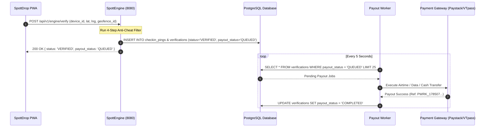
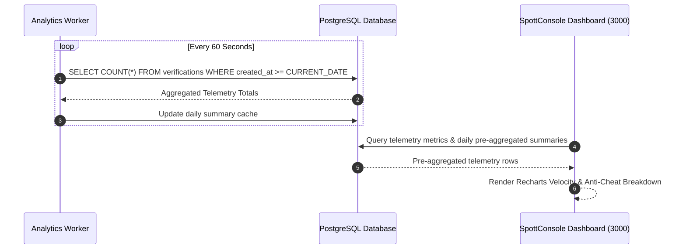

# Inter-App Communication Architecture

This document details how applications, services, and packages within the **SpottGeo Monorepo** communicate with each other, exchange data, enforce type contracts, and process asynchronous events.

---

## 🏛️ System Topology

```
+-----------------------------------------------------------------------------------+
|                                  CLIENT LAYER                                     |
|                                                                                   |
|   +-----------------------+   +-----------------------+   +-------------------+   |
|   |      SpottDrop        |   |      SpottVerify      |   |    SpottConsole   |   |
|   |  Consumer PWA (3001)  |   |  Consumer PWA (3002)  |   |  B2B Admin (3000) |   |
|   +-----------+-----------+   +-----------+-----------+   +---------+---------+   |
+---------------|---------------------------|-------------------------|-------------+
                |                           |                         |
                | HTTP POST                 | HTTP POST               | Direct DB &
                | /api/v1/engine/verify     | /api/v1/engine/verify   | Telemetry API
                v                           v                         v
+-----------------------------------------------------------------------------------+
|                                CORE API LAYER                                     |
|                                                                                   |
|                       +----------------------------------+                        |
|                       |           SpottEngine            |                        |
|                       |   Node.js + Fastify API (8080)   |                        |
|                       +-----------------+----------------+                        |
+-----------------------------------------|-----------------------------------------+
                                          |
                        Zod Schemas       | Drizzle ORM Queries
                  (@spottgeo/api-contracts) | (@spottgeo/database)
                                          v
+-----------------------------------------------------------------------------------+
|                                 DATA & WORKER LAYER                               |
|                                                                                   |
|                               +------------------+                                |
|                               | PostgreSQL DB    |                                |
|                               | (Table Queues)   |                                |
|                               +--------+---------+                                |
|                                        |                                          |
|            ┌───────────────────────────┼───────────────────────────┐              |
|            │ Polling Loop              │ Polling Loop              │ Aggregate    |
|            v (5s)                      v (10s)                     v (60s)        |
|  +-------------------+       +-------------------+       +-------------------+    |
|  |   Payout Worker   |       | Webhook Dispatcher|       | Analytics Worker  |    |
|  | (services/payout) |       | (services/webhook)|       | (services/analyt) |    |
|  +---------+---------+       +---------+---------+       +---------+---------+    |
+------------|---------------------------|---------------------------|--------------+
             |                           |                           |
             v                           v                           v
     External Gateways           Client Webhooks             Pre-Aggregated
   (Paystack/VTpass/FW)        (HMAC SHA-256 Signed)         Console Analytics
```

---

## 📡 Communication Mechanisms

Inter-app communication in SpottGeo uses four distinct patterns depending on latency and coupling requirements:

### 1. HTTP REST APIs (Synchronous Client-to-Engine)
- **Protocols**: HTTP/1.1 (JSON)
- **Primary Endpoint**: `POST /api/v1/engine/verify` hosted by `SpottEngine` on port 8080.
- **Participants**: `SpottDrop` (Consumer PWA) and `SpottVerify` (Attendance PWA) invoke `SpottEngine`.
- **Purpose**: Real-time verification of physical presence claims, anti-cheat evaluation, and instant decision feedback (sub-50ms latency).

### 2. Database Asynchronous Queues (Decoupled Worker Pattern)
- **Pattern**: Transactional Outbox / Table-as-Queue pattern over PostgreSQL.
- **Participants**: `SpottEngine` (Producer) $\rightarrow$ PostgreSQL $\rightarrow$ `PayoutWorker`, `WebhookDispatcher`, `AnalyticsWorker` (Consumers).
- **Purpose**:
  - `SpottEngine` writes verification records to the database with `payout_status = 'QUEUED'` during presence validation.
  - Background workers poll PostgreSQL at fixed intervals (`5000ms` for payouts, `10000ms` for webhooks, `60000ms` for telemetry pre-aggregation), eliminating HTTP coupling or main-thread blockages on user requests.

### 3. Shared TypeScript Data Layer (`@spottgeo/database`)
- **Library**: Drizzle ORM (`packages/database`).
- **Participants**: `SpottEngine`, `SpottConsole`, `PayoutWorker`, `WebhookDispatcher`, and `AnalyticsWorker`.
- **Purpose**:
  - Every server-side application imports a single, centralized database schema and parameterized SQL client from `@spottgeo/database`.
  - Ensures schema consistency across API routes, background workers, and admin actions.

### 4. Shared Contract Schemas (`@spottgeo/api-contracts`)
- **Library**: Zod (`packages/api-contracts`).
- **Participants**: All 10 packages in the monorepo.
- **Purpose**:
  - Request/Response payloads, query parameters, and domain interfaces are defined once in `@spottgeo/api-contracts`.
  - Prevents type drift between Next.js frontends (`SpottConsole`, `SpottDrop`, `SpottVerify`) and Fastify backends (`SpottEngine`).

---

## 🔄 End-to-End Execution Flows

### Flow 1: Presence Verification & Instant Reward Payout



---

### Flow 2: Signed Webhook Event Dispatching


---

### Flow 3: Analytics Pre-Aggregation & Executive Dashboard



---

## 🔌 Port & Protocol Matrix

| Service / App | Role | Port | Transport Protocol | Connected Services |
| :--- | :--- | :--- | :--- | :--- |
| **`@spottgeo/console`** | Next.js Enterprise Admin Dashboard | `3000` | HTTP / Next.js Server Actions | PostgreSQL Database, Browser Clients |
| **`@spottgeo/drop`** | Next.js Consumer Gamification PWA | `3001` | HTTP (Fetch Client) | `SpottEngine` (`:8080/api/v1/engine/verify`) |
| **`@spottgeo/verify`** | Next.js Standalone Check-In PWA | `3002` | HTTP (Fetch Client) | `SpottEngine` (`:8080/api/v1/engine/verify`) |
| **`@spottgeo/engine`** | Node.js Fastify Core Verification API | `8080` | REST API / PostgreSQL Client | `SpottDrop`, `SpottVerify`, PostgreSQL Database |
| **`@spottgeo/payout-worker`** | Asynchronous Payout Processor | Background Loop | PostgreSQL Polling / HTTPS External | PostgreSQL Database, Paystack / VTpass / Flutterwave APIs |
| **`@spottgeo/webhook-dispatcher`** | HMAC Webhook Dispatcher | Background Loop | PostgreSQL Polling / HTTP POST | PostgreSQL Database, External Client Webhook Endpoints |
| **`@spottgeo/analytics-worker`** | Telemetry Aggregator | Background Loop | PostgreSQL Polling / SQL Pre-Aggregation | PostgreSQL Database |

---

## 🔐 Security & Cryptographic Communication

1. **API Key Authentication**:
   - SpottConsole generates B2B SDK API keys using `spott_live_<32_random_bytes_hex>`.
   - Keys are stored in the `api_keys` PostgreSQL table strictly as **SHA-256 hashes** (`api_key_hash`).
   - Clients send `x-api-key: spott_live_...` in HTTP headers when calling `SpottEngine`.

2. **Webhook Cryptographic Signatures**:
   - Outbound webhooks sent by `WebhookDispatcher` include an `X-SpottGeo-Signature` HTTP header.
   - The signature is calculated using HMAC SHA-256 over the JSON body with the client's secret key:
     ```ts
     const signature = crypto.createHmac("sha256", secret).update(payloadString).digest("hex");
     ```

3. **Multi-Tenancy Isolation**:
   - All geofences, campaigns, API keys, and verification logs are partitioned by `tenant_id` (UUID) across database tables to guarantee enterprise data isolation.
